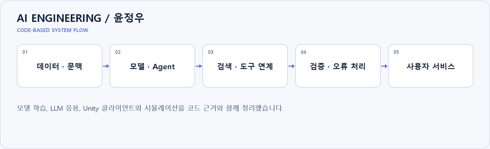

# 윤정우 | AI Engineering Portfolio

**데이터와 문맥을 모델·Agent에 연결하고, 결과를 사용 가능한 기능으로 구현합니다.**

소프트웨어융합학과 · 2027.02 졸업예정  
Python · 모델 학습/평가 · LLM Agent/RAG · Unity C#

[GitHub](https://github.com/a77315829-byte) · [Email](mailto:wjddn010108@naver.com)

[구성도 SVG 원본](docs/portfolio/engineering.svg)

## 프로젝트

모든 프로젝트를 같은 기준으로 정리했습니다. 각 저장소에서 처리 흐름, 본인 기여, 기술적 판단과 결과를 확인할 수 있습니다.

| 프로젝트 | AI·소프트웨어 기술 | 본인 역할 |
|---|---|---|
| [ANTITUDE](https://github.com/a77315829-byte/Capstone-ver0.1) | Python · FastAPI · React · TypeScript · MongoDB · Ollama · FAISS · KIS API | AI 활용 흐름 기획 · 웹/API 개발 · 기능 통합 |
| [OPENMOON / yullinmoon](https://github.com/a77315829-byte/yullin-moon-design) | Python · FastAPI · Pydantic · SQLAlchemy · SQLite · React · TypeScript · OpenAI / Anthropic | 초기 MVP 단독 구현 · 상담 Agent 확장 |
| [AI Agent Action Prediction](https://github.com/a77315829-byte/AI-Agent-Action-Prediction) | Python · PyTorch · Transformers · PEFT / LoRA · scikit-learn · LightGBM | 모델 개발 · 입력 표현 · 검증과 최종 구성 선택 |
| [Preference Prompt Tool](https://github.com/a77315829-byte/preference-prompt-tool) | Python · React · TypeScript/JavaScript · Bradley-Terry · GEPA · LiteLLM · SQLite | 선호 반영 구조 기획·개발 · 평가 방식 개선 |
| [SoccerMirrorGame](https://github.com/a77315829-byte/SoccerMirrorGame) | Unity · C# · ML-Agents · Mirror · Rigidbody · Command · SyncVar | Unity Soccer 예제 기반 확장 |
| [MOLE / EduMoleculAR](https://github.com/a77315829-byte/MOLE) | Unity · C# · Coroutine · UnityWebRequest · JsonUtility · FastAPI · PubMed | 논문 검색 · 공통 UI 개발 |
| [FLYHIGH Drone GCS](https://github.com/a77315829-byte/flyhigh-drone-gcs) | Python · Tkinter · pymavlink · ArduPilot SITL · Ollama · CSV | 프로그램 저작권 등록 |
| [AI-Generated Text Detection](https://github.com/a77315829-byte/AI-Generated-Text-Detection) | Python · PyTorch · Transformers · KULLM · BARTScore · KoELECTRA · Multi-GPU | 텍스트 판별 파이프라인 참여 |

[포트폴리오 PDF 다운로드](docs/portfolio/jeongwoo-yoon-ai-portfolio.pdf)

## 01. ANTITUDE

공시 검색과 투자자 Agent를 연결한 투자 판단 학습 플랫폼

2026.03 - 진행 중 | 5인 팀장 | AI 활용 흐름 기획 · 웹/API 개발 · 기능 통합

투자자 Agent, 공시 기반 RAG, 판단 학습 피드백의 목적과 전체 흐름을 기획했습니다. 웹 화면과 API를 개발하고 팀이 구현한 AI 모듈을 서비스에 통합했습니다.

뉴스·시세·공시와 Agent 분석을 하나의 학습 흐름으로 통합했습니다. 관련 RAISE 연구에 제2저자로 참여했고, 전역자금 플래너 확장 버전으로 해커톤 총장상을 받았습니다.

[코드 · 화면 · 구현 설명](https://github.com/a77315829-byte/Capstone-ver0.1)

## 02. OPENMOON / yullinmoon

LLM 구조화 추출과 검토 절차를 결합한 견적 업무 보조 시스템

2026.08.03 - 2026.09.07 | 기업협력 인턴 · 3인 팀 | 초기 MVP 단독 구현 · 상담 Agent 확장

초기 MVP를 단독 구현했습니다. 이후 팀 시스템에 전체 업무 상담 Agent를 추가하고 대화 맥락과 견적 변경 흐름을 보완했습니다. 사내 PC 기반 LAN 접속, NAS 연결과 사용 안내도 맡았습니다.

대화 테스트에서 앞서 말한 조건을 후속 답변에 반영하는 것을 확인했습니다. 추가 서버 비용 없이 사내 직원들이 공동 접속할 환경을 구성했습니다.

[코드 · 화면 · 구현 설명](https://github.com/a77315829-byte/yullin-moon-design)

## 03. AI Agent Action Prediction

대화·도구 이력으로 다음 행동 14종을 예측하는 언어모델 분류기

2026.07 | 5인 팀장 | 모델 개발 · 입력 표현 · 검증과 최종 구성 선택

대화·행동 문맥을 모델 입력으로 구성하고, 언어모델 분류기와 구조화 특징을 결합했습니다. 비교 실험과 검증 오류 점검, 최종 제출 구성 선택을 맡았습니다.

최종 Public Macro-F1 0.7894를 기록했습니다. 로컬 최고점, 독립 holdout, Public 결과와 추론 시 이용 가능한 정보를 구분해 모델을 선택했습니다.

[코드 · 화면 · 구현 설명](https://github.com/a77315829-byte/AI-Agent-Action-Prediction)

## 04. Preference Prompt Tool

사용자의 선택을 선호 추정과 재사용 가능한 프롬프트로 변환

2026.09 - 진행 중 | 3인 팀장 | 선호 반영 구조 기획·개발 · 평가 방식 개선

선택 기반 프롬프트 생성 도구를 기획하고, 선호를 반영하는 구조와 평가 방식 개선을 맡았습니다. 기능 구현과 품질 개선 실험을 구분해 기록했습니다.

프롬프트 생성·재사용 흐름과 React UI를 구현했습니다. Qwen의 30개 페르소나 비교에서 강한 비교군 대비 ROUGE-L 평균차 +0.0047, p=0.3616으로 유의한 우위는 확인하지 못했습니다.

[코드 · 화면 · 구현 설명](https://github.com/a77315829-byte/preference-prompt-tool)

## 05. SoccerMirrorGame

학습된 AI와 사람이 함께 플레이하는 Unity 네트워크 축구

2026.01 라오스 교육 준비·멘토링 | Unity Soccer 예제 기반 확장

교육용 축구 게임을 준비하고 프로젝트 구조와 확장 방법을 멘토링했습니다. AI와 사람의 제어 경로, 서버 물리와 경기 상태 동기화를 다뤘습니다. Unity의 기존 Soccer 예제를 기반으로 확장한 프로젝트입니다.

멘토링한 현지 팀이 최종 발표 1위를 기록했습니다. 학생들은 질문하고 직접 게임 기능을 바꿔보는 방식으로 참여했습니다.

[코드 · 화면 · 구현 설명](https://github.com/a77315829-byte/SoccerMirrorGame)

## 06. MOLE / EduMoleculAR

AI 화학 학습 서비스를 사용하는 Unity·C# 클라이언트

2025.03 - 2025.12 | 8인 팀 | 논문 검색 · 공통 UI 개발

논문 검색 화면과 Unity 공통 UI를 개발했습니다. 서버의 AI 챗봇·퀴즈 추천 모델은 팀 시스템 구성으로 구분하고, 본인 기여는 C# 클라이언트와 외부 서비스 연동에 둡니다.

검색 입력 → API 요청 → 응답 파싱 → 카드 생성 → 상세 확인을 연결했습니다. 팀 프로젝트는 창업경진대회 금상과 융복합지식학회 발표로 이어졌습니다.

[코드 · 화면 · 구현 설명](https://github.com/a77315829-byte/MOLE)

## 07. FLYHIGH Drone GCS

자연어 의도와 규칙 계산을 결합한 드론 관제 교육 도구

2026 | 개인 프로젝트 · 단독 개발 | 프로그램 저작권 등록

프로그램 기획·화면·MAVLink 통신·실습 안내·AI 보조 기능을 단독 개발했습니다. 실제 기체 대신 SITL을 사용하는 교육 프로그램입니다.

관제 조작·상태 관찰·명령 해설·실습 이력을 묶은 데스크톱 도구를 구현했습니다. 프로그램 저작권 제C-2026-031893호를 등록했습니다.

[코드 · 화면 · 구현 설명](https://github.com/a77315829-byte/flyhigh-drone-gcs)

## 08. AI-Generated Text Detection

LLM 교정문을 활용한 한국어 AI 생성 텍스트 판별

2025.06 - 2025.08 | 4인 팀 프로젝트 | 텍스트 판별 파이프라인 참여

4인 팀에서 LLM 교정·원문 비교·분류를 연결하는 파이프라인 구현에 참여하고 GPU별 추론 분할을 다뤘습니다. 아래 기술 구성과 대회 결과는 팀 프로젝트의 구현 범위입니다.

대회 기록 점수 0.78098, 상위 50%입니다. 이 경험을 바탕으로 라오스 SW·AI 교육에서 AI 생성 텍스트 판별 프로젝트 멘토링도 진행했습니다.

[코드 · 화면 · 구현 설명](https://github.com/a77315829-byte/AI-Generated-Text-Detection)

## 연구·수상

- RAISE: Rational-Aware Investment Scoring and Evaluation - 제2저자, PlatCon-26 발표 / Best Paper Award (2026.08).
- VIMAS: Visual Mission Authoring System for Ground Control Station - 제2저자, PlatCon-26 발표 (2026.08).
- AI 기반 3차원 시뮬레이션 화학 학습 시스템의 설계 및 구현 - 제2저자, 융복합지식학회 추계 발표 (2025.11).
- SW Start-Up Festa SW 해커톤 경진대회 총장상 (2026.09), 신한대학교 창업경진대회 금상 (2025.12).
- FLYHIGH Drone GCS 프로그램 저작권 등록 제C-2026-031893호.

## 협업·교육

- ㈜열린문디자인 기업협력 인턴: 초기 MVP 단독 구현, 상담 Agent·대화 맥락 보완, 사내 공동 접속 환경.
- 라오스국립대학교 SW·AI 교육: Unity 프로젝트와 AI 생성 텍스트 판별 멘토링. 현지 팀 최종 발표 1위.
- 인천청선학교: 사회복무 이후 교육·돌봄 봉사 299시간.

## 초기 버전과 교과 실습

| 저장소 | 관계 |
|---|---|
| [antitude-defense](https://github.com/a77315829-byte/antitude-defense) | ANTITUDE를 국방 주제로 확장한 해커톤 버전 |
| [yullinmoondesign_](https://github.com/a77315829-byte/yullinmoondesign_) | 업무 조회 도구·장기기억·대화형 견적 수정을 연결한 팀 시스템 |
| [Capstone-demo](https://github.com/a77315829-byte/Capstone-demo) | STOTRA 기반 화면과 Python 시뮬레이터 연동을 탐색한 초기 버전 |
| [mobile-app-programming10-2-](https://github.com/a77315829-byte/mobile-app-programming10-2-) | Kotlin UI 이벤트와 Activity 간 데이터 전달 |
| [homework1](https://github.com/a77315829-byte/homework1) | Switch·RadioGroup·버튼 이벤트로 화면 상태를 제어 |

초기·확장 버전은 같은 프로젝트의 발전 과정으로 구분하며 독립 성과로 중복 계산하지 않습니다.

프롬프트 도구는 최신 React 화면과 로컬 실행 안내를 제공합니다. 공개 배포 주소는 아직 없으며 이전 Streamlit 링크는 제거했습니다.
